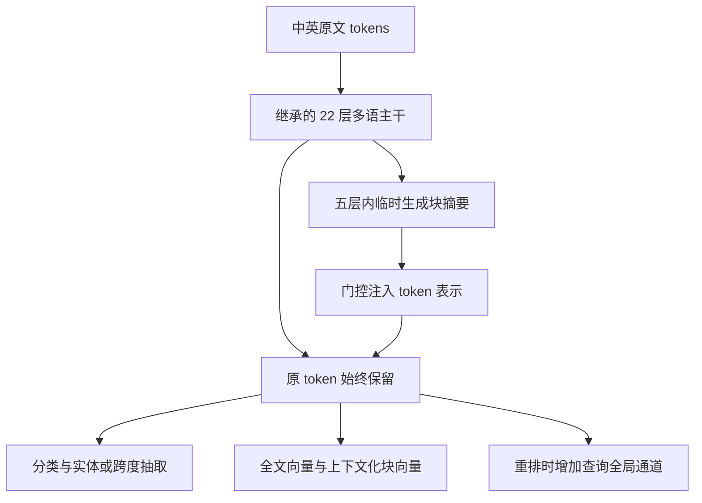

# 下一代 BERT：保留细粒度证据的长文双语编码器

> 课程：大语言模型与应用实践
> 约束：约 3 亿参数、8,192-token 上下文；中英文分类、抽取、检索与重排。
> 版本：深入调研修订版，2026 年 11 月 5 日。
> 状态：结构设计与实验计划，尚无训练结果；本文数值门槛和预算均为规划。初版在本地研究目录归档，不随代码仓库发布。

## 1. 设计主张：先找任务冲突，再决定结构

本题最值得研究的不是“多少层、选什么激活函数”，而是三个结构矛盾：

1. 分类和检索需要概括整篇文档，但抽取需要保留实体边界、数字、否定与精确位置。
2. 8K 的全局交互昂贵，但将远处信息全部压缩成摘要，又可能损失恰好决定答案的细节。
3. 检索要求文档可离线编码，重排则应充分利用当前查询；两者不能共用相同的交互约束。

因此提出一个研究候选：**在现代多语编码器上，保留 token 通道与少量完整全局层，用带门控的块摘要替代部分昂贵全局交互；检索输出全文语境下的分块表示，重排显式开放查询全局通道。** 下文简称“本文模型”，不把命名当作创新。

优先采用 `jhu-clsp/mmBERT-base` 继续适配。结构、词表与大部分权重继承已有模型；新增参数主要是摘要池化和门控，不另建一个大型编码器。核心研究问题是：**在固定新增计算下，能否减少昂贵交互，又不丢失长文中的关键证据？**

这是一项任务驱动的结构改造与验证计划。分层编码、摘要 attention、门控、多向量表示和查询全局 attention 均有先例；本文不声称它们分别是原创，也不能凭有限检索宣布组合“全球首次”。只有实验证明组合相对最近方法具有可解释优势后，才可能形成研究贡献。

## 2. 文献给出的设计边界

以下只列与决策直接有关的结论。原论文在其他规模、语言或硬件的结果，不作为本文的性能保证。

| 研究 | 值得借鉴的机制 | 对本题的限制／启发 |
| --- | --- | --- |
| [ModernBERT](https://arxiv.org/abs/2412.13663) | 现代双向主干与局部／全局交替，重视实际运行效率 | 适合作默认基线；不能仅换几个尺寸就算新架构 |
| [mmBERT](https://arxiv.org/abs/2509.06888) | 将现代编码器扩展到多语，提供约 307M、8K 的起点 | 适合本题；论文指出结构化预测仍有 tokenizer 相关限制，抽取必须单独验证 |
| [mGTE](https://arxiv.org/abs/2407.19669) | 长上下文多语表示与重排 | 保留作独立参考；不同训练历史的模型差异不能用于结构归因 |
| [Longformer](https://arxiv.org/abs/2004.05150) | 局部 attention 与任务相关的全局 token | 支持查询全局通道的设计依据；不把该机制称为新发明 |
| [BigBird](https://arxiv.org/abs/2007.14062) | 局部、随机与全局连接 | 稀疏图可保持远距连接，但理论表达能力不保证有限预算下学得好 |
| [LongT5](https://arxiv.org/abs/2112.07916) | 从块内 token 构造临时全局摘要 | 是本文摘要分支的直接先例，必须设置简化复现对照 |
| [HAT](https://arxiv.org/abs/2210.05529)／[HDT](https://arxiv.org/abs/2407.08330) | 跨段上下文化和结构化层级连接 | 支持中间层交流；文档层级不可靠、细节压缩与 kernel 成本需要控制 |
| [NSA](https://arxiv.org/abs/2502.11089)／[MoBA](https://arxiv.org/abs/2502.13189) | 压缩与精细选择、按块路由 | 证明“压缩＋细节路径”已有研究；其长序列 LLM 实现收益不能直接推给 8K 编码器 |
| [Late Chunking](https://arxiv.org/abs/2409.04701) | 全文编码后再池化 chunk，保留上下文 | 直接用于检索对照；仅改 pooling 并不构成新的主干 |
| [ConTEB／InSeNT](https://arxiv.org/abs/2505.24782) | 测文档语境依赖，并区分同文档内相似片段 | 警惕语境污染：同文档各段可能变得难以区分；需同文档负例 |
| [ColBERTv2](https://arxiv.org/abs/2112.01488)／[BGE-M3](https://arxiv.org/abs/2402.03216) | 多粒度与延迟交互 | 精细相关性以索引和打分成本为代价；不默认保存所有 token 向量 |

调研后放弃两种看似新颖但当前不划算的方案：直接搬入完整 NSA／MoBA 会增加路由、训练和 kernel 验证负担；完全层级压缩则可能为了分类效率牺牲抽取。本文选择可从现成权重逐步适配、可分别否决的较小改造。

## 3. 默认配置：继承什么，新增什么

### 3.1 起点与参数口径

mmBERT 论文与当前官方配置给出：22 层、隐藏维度 768、12 个头、GeGLU 中间维度配置为 1,152、256,000 词表、最长 8,192，原配置每三层全局 attention。本文保留这些结构与词表。[论文 §3.1](https://arxiv.org/html/2509.06888v1)、[官方配置](https://huggingface.co/jhu-clsp/mmBERT-base/blob/main/config.json)。

这里的门控中间维度必须按实现口径计数：如果线性层输出 2m 再切成两路，则配置中的 m=1,152，而非 2,304。忽略小项，基础参数近似：

\[
P=Vd+L(4d^2+3dm)
 =196.608\mathrm{M}+110.297\mathrm{M}
 \approx306.905\mathrm{M}.
\]

加归一化、MLM 变换与偏置后约 307M，与论文规模相符；最终以加载后的实际计数为准。本文五个摘要层的池化查询与门控约新增 50K 参数，128 维检索投影新增约 98K，任务头和可选 LoRA 另外记账，总规模仍约 3.1 亿。

若“3 亿”被严格解释为不得超过 300,000,000，而不是近似约束，则这一检查点不合规，应另做容量调整；本题明确使用“约”，本文采用约 307M 的现成起点。

### 3.2 默认值与待验证假设

| 项目 | 本文默认 | 状态 |
| --- | --- | --- |
| 深度／宽度／词表 | 继承 mmBERT | 默认固定，优先花预算验证结构机制 |
| 位置与归一化 | 保留原位置实现、Pre-LayerNorm 与末端归一化 | 不借继续适配之名擅自替换 |
| 前馈 | 保留 GeGLU | SwiGLU 仅作为后续等容量消融 |
| 普通局部层 | 保留原 checkpoint 窗口语义 | 实现前核对左右半径及端点；不混用“总宽度／半径” |
| 新摘要层的局部分支 | 初始左右半径 64，即最多 129 个原文位置 | 待验证；失败时增至 128 |
| 完整全局层 | 保留 3 层，详见下节 | 核心假设，不能预先认定足够 |
| 摘要粒度 | 每 256 个原文 tokens 一块；每块 2 个摘要槽 | 与单均值摘要、不同块长对照 |
| 文档表示 | 一个全局向量；检索时另取上下文化块向量 | 按任务启用，并报告额外存储 |
| 重排 | 仅重排路径开放查询全局通道 | 独立消融；检索建库时无查询信息 |

继续适配保留原词表。先审计每千汉字 token 数、英文子词碎片、混合文本长度、实体边界映射和分词耗时。mmBERT 论文所述 prefix-space 问题提示抽取风险；必须在原文字符 offsets 上测实体／跨度，不能把 tokenizer 对齐错误误判为 attention 退化。临时换 tokenizer 会破坏词义映射，并不属于免费修复。

若未来从头训练，才在固定原文上比较 32K／64K／96K 中英词表，并在总参数约束下重新分配 embedding 与主干容量；不再先指定一个漂亮的 24 层、896 维表格。LayerNorm／RMSNorm 和 GeGLU／SwiGLU 也要分别做等容量实验，再按目标硬件的实际 kernel 选择。

## 4. 核心结构一：保留原 token 的摘要交互

### 4.1 哪些层改变

按现代编码器实现中常见的 0 起始索引，原 mmBERT 全局层应为 0、3、6、9、12、15、18、21；加载固定源码后先核对这一规则。本文候选保留 0、9、21 层完整全局 attention，将 3、6、12、15、18 层改成“局部＋摘要”层，其余 14 层保留原局部 attention。对应 1 起始编号：

- 完整全局：第 1、10、22 层。
- 局部＋摘要：第 4、7、13、16、19 层。
- 其他层：保持局部。

保留首层让早期 token 获得全局背景；保留中层和末层，为摘要无法表达的实体、数值和跨段关系保留直接路径。这个放置方案是可证伪的起点，不声称三个位置最优。若失败，优先恢复第 16 层为完整全局，再考虑加宽局部窗口。

### 4.2 摘要怎样形成

令当前层归一化后的 token 表示为 \(x_i\in\mathbb R^d\)。每份文档独立划分为长度最多 256 的块 \(B_b\)，padding 与特殊 token 不参与池化。对于每块构造两个临时摘要：

\[
s_{b,1}=\frac1{|B_b|}\sum_{i\in B_b}x_i,
\qquad
s_{b,2}=\sum_{i\in B_b}a_{bi}x_i,
\qquad
a_{bi}=\operatorname{softmax}_{i\in B_b}
 \left(e^\top x_i/\sqrt d\right).
\]

第一个摘要保留均值背景；第二个使用每层共享的可训练向量 e 做注意力池化，尝试保留非平均信息。它不保证自动成为“实体摘要”或“证据摘要”；必须检查其是否坍缩成均值、是否只关注标点，以及能否改善稀有事实任务。

两个摘要均从当前实际输入计算：若输入经过 MLM 腐蚀，它们也只能读取腐蚀后的表示，不能访问未遮盖原文。摘要不插入原始 token 序列，因而不占用 8K 原文位置，也不改变字符跨度映射。它们每层重算，不是跨请求缓存或额外记忆。

### 4.3 局部结果和摘要结果怎样融合

复用该层原有 Q/K/V/O 投影，分别算两个 attention 结果：

\[
z^{\mathrm{loc}}_{i,h}=
\operatorname{Attn}(q_{i,h},K_{\mathcal N(i),h},V_{\mathcal N(i),h}),
\quad
z^{\mathrm{sum}}_{i,h}=
\operatorname{Attn}(q_{i,h},K_{S,h},V_{S,h}).
\]

局部 attention 与摘要 attention 各自 softmax，不把两份输出当成同一分布。每个 token、每个头有一个门控：

\[
g_{i,h}=\sigma(u_h^\top x_i+b_h),
\qquad
z_{i,h}=(1-g_{i,h})z^{\mathrm{loc}}_{i,h}
          +g_{i,h}z^{\mathrm{sum}}_{i,h}.
\]

拼接各头后，经原 O 投影、残差与 FFN，**所有原 token 始终保留**。这与把整段原文永久缩成几个向量再做抽取不同。门控目的是让模型按 token 决定背景注入程度，不预设“实体必须关闭门控”；需要用有无门控和常数门控对照判断其价值。

初始令 u=0、b=-4，使摘要权重较小但梯度非零；池化向量 e 小幅随机初始化。关闭摘要分支仅能恢复“减少全局层后的局部模型”，不能恢复原始 mmBERT，因为五个原全局层已被替换。必须正面测量这部分结构冲击。

位置上，局部原 token 沿用原位置编号；摘要 key 暂取其块的中心位置，沿用被替换层的 RoPE 参数；不在此时更改 theta 或增加一套未解释的位置机制。块中心是近似，会丢失块内位置差异，因此精确位置关系仍依靠 token 通道和完整全局层。不同层不能跨文档聚合。

### 4.4 迁移训练不能伪装成无损替换

先做直接替换的短程／长程诊断。默认训练最初 10% 计算额度采用平滑过渡：

\[
z(t)=(1-\lambda(t))z^{\mathrm{old\ global}}
          +\lambda(t)z^{\mathrm{new}},
\quad \lambda:0\rightarrow1.
\]

这一阶段执行两条路径，额外计算全部计入。后 90% 只执行新路径；所有减全局层对照采用相同过渡规则。若实验发现直接替换不需要过渡，则去掉它。冻结原模型作 teacher 的蒸馏只作为失败后的修复项，不默认再加一个 loss。

### 4.5 代价估算与真实瓶颈

在 n=8,192、局部可见宽度 w≈129、摘要数 K=2×ceil(n/256)=64 时，每个摘要层的 attention 配对量约为 \(n(w+K)\)，而非 \(n^2\)。忽略边界、头数与维度，原始结构和候选结构约为：

\[
A_0=8n^2+14nw,\qquad
A_1=3n^2+19nw+5nK.
\]

这表明**attention 配对量**约降至原来的 41%，不是整模型 FLOPs 或延迟降到 41%。FFN、投影、词表头、摘要池化、过渡训练与 kernel 启动都未包含在内。8K 下仍有三个完整全局层，因此本文模型仍含二次项，不宣传为线性复杂度。

n 增长时 K 也随块数增长，\(nK\) 本身约为 \(O(n^2/256)\)。即使去掉所有完整全局层，也不能在固定块长下称它严格线性。这是与简单“局部窗口所以线性”说法的区别。

## 5. 核心结构二：检索保留块证据，而非只保留一个均值

### 5.1 为什么改输出结构

长文检索可能只需要文档中的一小段。将 8K tokens 一次均值池化，相关片段可能被大量无关内容稀释；先切块再编码，又会丢失指代与上下文。采用全文编码后分块池化，属于已有 late chunking 思路，不把这一点写成独创。

输出分为两类：全局向量 \(v_d\in\mathbb R^{768}\)，以及至多 32 个 256-token 块向量 \(c_b\in\mathbb R^{128}\)。两者均从**最终 token 表示**池化、投影和归一化；不直接把内部临时摘要当成已训练好的检索向量，从而分离“主干信息传递”和“索引输出”。

文档向量与块向量都离线生成，不依赖当前 query。query 则得到全局向量 v_q 和最多 64 个 token 的投影向量 Q_i。候选评分为：

\[
s_{\mathrm{block}}(q,d)=\frac1{|q|}\sum_{i\in q}
                     \max_b Q_i^\top c_b,
\qquad
s(q,d)=\alpha\,v_q^\top v_d+(1-\alpha)s_{\mathrm{block}}(q,d).
\]

初始 α=0.5，仅在训练内 dev 比较 0、0.5、1。该分数是 query-token 对 document-block 的粗粒度延迟交互，不等同于原 ColBERT 的 token-token MaxSim。可能的缺点是无法区分同一块内的细节、max 得分偏好块数多的文档，以及多证据被分散匹配；这些都要诊断。

### 5.2 默认部署与公平基线

默认先用全局向量 ANN 取 top-100，再按块分数重排这一固定候选集。这样块表示不能补救未召回的文档；必须同时报告 Recall@100 上限。若全局召回不足，再单列块向量 ANN 的全库候选扩展实验，计入更多索引和查询工作，不把它混入相同候选实验。

必须比较四组：单向量；独立分块后编码；原主干全文编码后的分块；本文主干全文编码后的分块。后三者使用相同块边界、128 维输出、打分方式、候选集与块数上限。特别是“原主干＋late chunking”是必备最近基线，否则任何收益都可能仅来自成熟的输出方案。

存储代价并不小：最坏每文档 32×128 个 FP16 块向量为 8,192 字节，再加 768 维全局向量 1,536 字节，总计 9,728 字节；百万个满长文档约 9.728GB 原始向量，约为单向量的 6.3 倍，尚未包含索引、ID 与元数据。按真实长度另报平均值；减少至 8／16 块或量化属于额外质量—成本消融。

## 6. 核心结构三：重排时让查询直接接触全文

离线检索不能使用 query-conditioned 文档表示，但在线 cross-encoder 可以。将输入设为 query 与 document 拼接，总长度含特殊 token 不超过 8,192；先保留最多 64 query tokens，其余分给文档。分类和抽取没有 query 时不启用此模式。

在局部层与新摘要层中：

- query tokens 可以读取全部原始 document tokens；
- document tokens 可读取全部 query tokens，以及原局部邻域；
- 摘要层还使用文档内部摘要；query 不混入文档摘要池化；
- 原三层完整全局 attention 保持不变。

局部集合与 query 集合重叠时去重，避免一个 token 以两种身份重复进入 softmax。query 行使用全局原 token attention；document 行的“局部＋query”分支和摘要分支按上节门控融合。原本的局部 RoPE 参数保持不变，不因新开一条边同时改位置编码。

query 全局通道是 Longformer 一类任务全局 attention 的应用，不是本文首创。本文要验证的是：**在减少完整全局层后，用约 O(nq) 的查询相关交互，能否恢复或提升长文重排，而不恢复全部 O(n²) 的 token-token 交互？** 当 q≈64 时仍需按真实层数和 kernel 计费。

所有重排组使用同一 scoring head，例如最终 query tokens 的 masked mean 接一层线性输出；相同 top-100 候选、训练正负例和 query 长度。不能把 head 或候选数变化的收益算给 query 通道。检索向量分数与 cross-encoder 重排分别报告，不把两个阶段合并成一个无法归因的指标。

## 7. 创新边界：什么值得主张，什么不值得

| 内容 | 定性 | 必须给出的证据 |
| --- | --- | --- |
| RoPE、Pre-LN、GeGLU、每隔数层全局 | 继承的现代编码器默认件 | 兼容性与系统测量，不包装成创新 |
| 临时摘要、分层交流、门控 | 已有研究方向 | 对照 LongT5 式均值摘要与更简单模型 |
| 两类摘要槽＋token 级门控＋保留直接全局层 | 本题提出的具体改造假设 | 证明较单摘要、无门控、只减全局层更好；证明细节确实保留 |
| late chunking、块向量、查询全局通道 | 已有方法的任务适配 | 各自最近基线与同成本比较 |
| 同时覆盖四类任务的取舍和证伪方案 | 课程项目可成立的贡献 | 所有正负结果公开；限制清楚；结论不超过数据 |

更有价值的结论可能是“摘要分支在分类有效，但会损伤数字抽取，因此保留四个全局层”；也可能是“原 mmBERT 加 late chunking 已足够，新主干不值得”。这两种结果都比换一个名字并宣称创新更可信。

## 8. 学习目标：结构改造不等于叠加所有损失

| 目标 | 补什么 | 本文安排 |
| --- | --- | --- |
| 动态 MLM | 双向语言与词汇表示，适配中英文分布 | 主干结构适配的默认目标 |
| 连续片段恢复 | 短语与实体组合，降低逐词猜测捷径 | 50% MLM batch 的腐蚀候选，遮盖总比例仍为 15%；结构主消融先固定不用 |
| ELECTRA／DeBERTaV3 式 RTD | 所有位置的替换判别，较密 token 监督 | 作为替代预训练分支，非默认附加项 |
| SimCSE 式对比 | 句／块向量几何与相关性 | MLM 后仅在检索分支使用；有标注时优先相关性正负对 |
| Text Diffusion | 生成、编辑和补全 | 新用途分支，不是四类理解任务的必要组件 |

片段遮盖实验仅改变腐蚀分布，不冒充包含边界目标的完整 [SpanBERT](https://arxiv.org/abs/1907.10529)。RTD 中生成器以 MLM 训练、判别器学习替换标签；生成器采样恰好等于原词时标为未替换。DeBERTaV3 式嵌入共享若采用，需处理梯度冲突；生成器的参数、前向、训练与采样均计费。[ELECTRA](https://arxiv.org/abs/2003.10555)、[DeBERTaV3](https://arxiv.org/abs/2111.09543)。

无监督 SimCSE 依赖两个独立 dropout 视图，但当前 mmBERT 的原生 dropout 配置为 0；两个相同的确定性前向不能冒充有效增强。若使用该目标，需明确新增 dropout 并配对照；默认直接用相关 query—document 对，降低无关变量。[SimCSE](https://arxiv.org/abs/2104.08821)。

阶段安排：

1. **结构适配阶段**：动态 MLM，15% 遮盖；所有结构组使用同样腐蚀、长度与中英配比。先不加入 RTD、对比或片段遮盖。
2. **任务阶段**：分类／抽取使用各自小 head；检索训练相关性；重排训练 query—document 交互。各任务可保存独立 LoRA 与 head，共享冻结底座时必须列明运行方式。
3. **检索细化阶段**：只有已有 chunk 正标签时，加入已确认不相关的同文档 chunk 作为负例，以减少全文语境导致的表示同质化；未标注同文档块不能一律视作负例。多正例采用多正标签处理。
4. **可选目标对照**：单独测试片段遮盖或 RTD；同数据、同计算比较，不让目标收益污染结构消融。

Diffusion 需要噪声强度分布、相应加权损失与反向采样；是否显式输入时间依所选参数化决定。不能因为双向 MLM 能填空就宣布具备扩散生成能力。若以后增加，单独记录生成质量与多步前向成本。[Masked Diffusion Language Models](https://arxiv.org/abs/2406.07524)。

## 9. 实验设计：优先证明三项结构变化

### 9.1 共同基线与控制

B-init 是不做新增结构适配的原 mmBERT；B0 是保留原结构、接受与候选相同新增数据和任务训练的 mmBERT。主要归因采用 B0。原版 ModernBERT、mGTE 或 BGE-M3 仅作为系统参考，因参数／语言／历史计算不同，不充当严格因果基线。

所有主组固定 tokenizer、原始权重 revision、precision、训练模块、优化器、数据池、任务标签与调参次数。若采用 LoRA，各组 q/k/v/o 与 FFN 的相同线性模块均用 rank=16；新增门控与池化参数正常训练，对照组另提供同参数量局部适配器检查，排除“只是多了参数”。

### 9.2 E1：摘要交互是否值得

| 组别 | 结构 | 回答的问题 |
| --- | --- | --- |
| B0 | 原每三层全局的 mmBERT | 强默认基线 |
| L3 | 只保留第 1／10／22 层全局，其他原全局改成局部 | 单纯减少全局层的损失与收益 |
| M1 | L3 的五个改动层加单均值摘要、固定混合权重 | 接近 LongT5 思路的简化双向移植；不是完整复现 LongT5 |
| M2 | 两个摘要槽、固定混合权重 | 第二个摘要槽是否有用 |
| G2 | 两个摘要槽、按 token／head 门控 | 门控是否改善背景与细节的取舍 |

M1／M2 固定混合权重 0.5；G2 再加一个可学习常数门控对照，判断是否真需要 token 级自适应。仅在筛选显示有潜力后运行该补充，不一开始铺大网格。摘要数、attention 额外成本全部入账；不能仅凭 G2 比 L3 好就宣布新结构优于原模型。

主要看中英 NER／QA、长文分类、长程证据及 8K 成本。若 M1 已足够，就删除第二槽和复杂门控；若三个全局层不足，追加四全局版本并重新比较成本。块长只在 128／256／512 中按 train-dev 选择，其他主条件固定。

### 9.3 E2：表示粒度与全文语境是否值得

在 B0 上先比较单向量、独立分块、late chunking；再在 E1 胜出主干上用相同表示方案比较。所有组共享 query／document 监督与评分规则。独立分块与 late chunking 的向量个数、维度、边界和候选集相同；单向量组另列较小索引成本。

训练策略区分“无额外训练，仅改变池化”和“同数据同预算对比适配”，防止把后训练收益算给结构。固定每个 query 的候选集与精确块打分，先隔离表示作用；再做 ANN 全系统比较。ConTEB 仅作其支持语言的额外诊断，不能把英文结果当成中文证据。

E2 要回答：在同索引预算下，全局语境是否让块向量更好？它也可能让相近段落混淆，因此除文档 nDCG 之外，测证据块 Recall@k／MRR 和同文档错误定位率。没有块标签时只报文档指标，不推断定位成功。

### 9.4 E3：查询全局通道是否值得

在 E1 胜出主干上比较：原有交互 mask、不改变 head 只增加查询全局通道，以及恢复更多完整全局层。相同 top-100 候选、相同 query／document 长度、同训练对和任务计算；用 B0 cross-encoder 作为原结构上界参考，不能称为理论上界。

重点把相关证据放在文档末尾、中间与远离 query 的位置，并增加词面相似但否定相反的候选。若 query 通道改善只来自候选改变，或在已有完整全局层下没有增益，则不采用。仅存在长文增益时，可按任务配置启用；短文默认走较简单的原路径，并把两套运行策略的维护成本列出。

### 9.5 组合与结论范围

E1、E2、E3 分别成立后，才确认组合模型。对比“B0＋late chunking＋query 通道”是必需的，防止成熟任务头方案已经解释所有收益。最后做组合的逐项移除；若只能承担部分实验，就报告部分结论，不把未运行的组合写成结果。

## 10. 数据和任务：匹配真实需求而非只刷短句分数

### 10.1 固定新增训练池

| 池 | 来源与冻结规模 | 用法 |
| --- | --- | --- |
| U 无监督 | Wikipedia `20231101.zh`／`20231101.en`，清洗后各最多 50M 起点 tokenizer tokens | 文档 hash 固定 99:1 train/dev；真实长文，不以不相关拼接冒充长文 |
| P 相关性 | mMARCO 中英 train 各 20K queries；每 query 正例与 7 个预先固定负例 | 按原始 query ID 切 90:10，译文不得跨切分 |
| D 长文 | MLDR 中英 train 各最多 2K queries 及其正负文档 | E1 只读允许的原文；E2/E3 才用关系标签；所有对照权限相同 |
| A 抽取派生 | CMRC2018／SQuAD train 中有答案跨度的文档样本，各最多 2K | 可构造块定位训练；不把缺少答案字符串等同于严格负例 |

U 提供结构适配，P 提供基本相关性，D 提供真实长文场景，A 可提供证据定位监督。mMARCO 主要是 passage 级数据，不能声称它足以训练 8K 的跨段理解。若 D 不足以构成长文确认集，应缩小结论，而不是生成大量未核验伪标签凑规模。

固定来源 revision、文本 ID、SHA-256、清洗与去重、语言比例、长度桶、负例和顺序；只去除**新增训练池**与锁定评估的重合，无法保证继承模型没有历史污染。检索评估 corpus 允许离线建索引，但不进入模型更新。数据来源：[Wikipedia](https://huggingface.co/datasets/wikimedia/wikipedia)、[mMARCO](https://github.com/unicamp-dl/mMARCO)、[MLDR](https://github.com/FlagOpen/FlagEmbedding/blob/master/research/C_MTEB/MLDR/README.md)。

### 10.2 四类任务与保留能力

| 能力 | 核心评估 | 指标 |
| --- | --- | --- |
| 分类 | XNLI 中英；TNEWS 中文扩展 | Accuracy／macro-F1；只测这一组不能声称长文分类改善 |
| 长文分类 | 跨段关系／否定诊断；真实任务扩展用中文 THUCNews 正文、英文 Hyperpartisan | Accuracy／macro-F1、最差位置；按真实 token 长度分桶，短文不能冒充 8K 任务 |
| 抽取 | WikiANN 中英 NER；CMRC2018／SQuAD QA | 实体级 F1、EM／F1、原文字符偏移正确率 |
| 检索 | MIRACL 中英；MLDR 中英 | nDCG@10、Recall@100；有标签时加证据块 Recall@k |
| 重排 | 固定 BM25 或 B0 向量召回的 top-100 | nDCG@10／MRR@10 与候选召回上限 |
| 原能力 | 中英短任务＋德法 XNLI／WikiANN | 适配前后差值、逐语言最差项 |

官方定义与脚本：[XTREME](https://github.com/google-research/xtreme)、[CLUE](https://github.com/CLUEbenchmark/CLUE)、[MIRACL](https://github.com/project-miracl/miracl)。本地使用有标签 dev 作锁定评估时，从 train 另切调参集；不反复读取评估结果调结构。合成诊断、MLDR 和 ConTEB 各有语言／构造限制，需交叉印证。

长文分类扩展必须用 [THUCNews 官方正文语料](https://github.com/thunlp/THUCTC)，不能误用网上同名的标题子集；按类别与长度分层选至多 10K 正文，近重复聚类后以文档组 hash 固定 80:10:10。英文 [Hyperpartisan](https://pan.webis.de/semeval19/semeval19-web/) 优先采用人工标注部分的官方划分；弱标签训练与人工标注测试分开记账。两者都先统计长度分布；如果真实 4K–8K 样本很少，只支持较短文档分类结论。真实新闻标签也可能存在局部词汇捷径，因此仍保留跨段干预诊断。

## 11. 证据干预：验证“保留细节”而非只让图连通

构造中英各 600 个基础样本：300 train、100 dev、200 test，按来源、实体组合与模板族切分。每个基础样本派生不同长度和位置变体，统计按基础样本聚类。

1. **稀有事实密度**：同一块放 1／8／32 个低频实体、数字或否定事实，问其中一个。检验第二摘要槽是否避免平均压缩损失；它也可能完全失败。
2. **边界扰动**：把同一实体或证据移到块边界两侧，使用 0／64／128-token 起始偏移，检查模型是否依赖固定切块；不为每个位置另训一套模型。
3. **跨段组合**：两条必要证据相距 128／1K／4K／接近 8K；分别删除任一条后应无法确定答案。
4. **反事实翻转**：只修改一个数值、关系或否定词，要求预测正确改变；报告原本正确样本上的正确翻转，不把任意变化当成功。
5. **语境污染**：同一文档相邻块共享背景，但只有一块真正回答 query；同时测文档命中与证据定位。
6. **长程位置**：关键证据在开头／中部／末尾，报告最差位置和相对近距离的退化。

自动生成后人工抽查每语言至少 50 条；缺失证据样本要有明确的“无法判断”标签。记录块摘要池化权重、两摘要余弦相似度和门控分布只作诊断；attention／gate 图本身不证明因果使用。真正的证据是删除、替换与通道关闭后行为发生预期变化。

## 12. 计算公平、部署与本机可行性

### 12.1 两种公平分别报告

**等新增计算为主。** 用 profiler 与解析公式校准训练 FLOPs，累计相同额度停止；包含门控、池化、双路径过渡、辅助头、任务适配、重计算及失败调参。记录有效 tokens、重复曝光、GPU 时间和峰值显存。继承模型历史训练成本单列，不能声称整个研究只花新增预算。

**等数据为辅。** 固定同一文档、腐蚀、正负对与训练次数，在共同检查点比较；因此计算可以不同。不能同时用“等步数、等 tokens”代替“等 FLOPs”。另外给出等 GPU 时间上的质量，区分结构收益和实现效率。

E1 固定目标与数据；E2 固定标签权限与索引；E3 固定候选与 head。参数总量接近不代表 FLOPs 接近，3 亿参数被大词表占去多少也要列明。

起始优化设置为 AdamW、weight decay=0.01、梯度裁剪=1；全参学习率只在 1e-5／3e-5、LoRA 在 1e-4／3e-4 中用 train-dev 选择，所有组搜索次数相同。学习率前 5% 计算额度 warmup、随后衰减；结构过渡的 10% 额度独立记录。长度按未填充 tokens 分配：前 20% 使用 512 上限，其余在 512／2K／8K 按 30%／30%／40% 分桶，语言在各桶内尽量平衡。不足的长文数量和重复曝光必须报告。固定 seeds 和检查点位置，避免各组任意早停形成预算差异。

### 12.2 模型结构与实现优化分开

局部／摘要连接、保留哪些全局层、门控与查询可见范围属于结构。FlashAttention／SDPA、unpadding、packing、编译、precision 与重计算属于实现。稠密 8K mask 仅用于正确性参考，不能据此报告稀疏效率。

摘要分支可由短 key/value 的 dense cross-attention 实现；局部分支需要真正的窗口 kernel，query-global 需要不规则或分块计算。不能假设现成 mmBERT kernel 无修改即可支持本文结构。先分别测输出与梯度，核对文档隔离、RoPE、padding、跨度映射和重复 query key，再测 512／2K／4K／8K。

所有结构组先使用成熟度相当的实现比较；另列各模型最佳部署实现。kernel 版本、GPU 驱动和编译选项需要在实际机器确认，不因某库名称就声称支持 RTX 5070。

### 12.3 RTX 5070 与 Mac 的分工

MacBook Pro M3 Pro 18GB 用于分词、数据审计与短长度参考；RTX 5070 12GB 用于训练 pilot 和推理测量。约 307M 权重能放入显存，不代表 8K 全参训练或长文负例 batch 能放下。

先尝试 microbatch=1、混合精度、gradient checkpointing；若全参不可行，所有组统一转 LoRA，不能只给候选使用节省显存手段。有效负例 batch 可先设 16 queries、每 query 7 个固定负例；使用梯度缓存时另计重计算，普通梯度累积不会自动扩大 in-batch negatives。8K 文档候选可顺序计算，仍需正确保留梯度或使用可验证缓存方案。

| 阶段 | 计划额度 | 退出条件 |
| --- | --- | --- |
| Pilot | 最多 2 GPU 小时 | 8K 路径、精度或显存不成立时先修复／申请更大显存，不启动长训练 |
| E1 筛选 | B0、L3、M1、M2、G2；各 1 seed，统一 FLOPs 额度 | 额度按 pilot 中 B0 约 1 小时可完成量设定；每组最多 2 小时时间上限 |
| E2/E3 筛选 | 优先复用 E1 检查点；每项 2–3 个固定对照 | 每项最多预留 6 GPU 小时，未完成如实标记 |
| 确认 | B0 与最有潜力候选，3 seeds：17、42、2026 | 每 run 按 B0 约 4 小时可完成 FLOPs 设额；每 run 最多 6 小时 |
| 任务与部署评估 | 先预留 12 GPU 小时 | 只缩减扩展任务，保留核心任务、长程、遗忘、成本四类证据 |

按上限合计约 72 GPU 小时，是资源分配，不是运行耗时预测，也不保证足以得出显著结果。所有组若无法在时间上限完成统一 FLOPs，应在看锁定评估前统一降低额度。完整 E1 门控细分、所有任务三 seed 和组合逐项消融需追加预算；未确认的组件只能称候选。

如果 8K LoRA 仍不可行，小模型／4K 只能提供机制 pilot，不能充当约 3 亿参数、8K 的最终证据。本次不安装环境、不下载大权重、不启动训练。

### 12.4 部署测量

在同一硬件、precision、输入分布上，预热 20 次、至少计时 100 次、重复三轮，GPU 同步后统计 p50／p95、有效 tokens/s、docs/s、峰值分配／保留显存和 OOM。分别报告纯模型与含分词、搬运、池化、ANN 和块打分的端到端时间；编译冷启动单列。

检索同时报告离线建库、全局索引、块向量读取与固定 top-100 打分；重排记录 top-10／50／100 成本。多个任务 LoRA 的存储、切换与并发成本单列，不把多分支当成免费。

## 13. 什么结果会推翻设计

所有质量指标按 0–100 记“百分点”；阈值为本文预先设定的工程标准。报告三 seed 均值／标准差与逐 seed 差；query、文档或基础诊断样本配对 bootstrap，主要检验采用 Holm 校正。样本区间不能代替训练随机性，区间过宽即证据不足。

| 假设 | 采用门槛 | 否决／回退 |
| --- | --- | --- |
| 摘要可替代部分全局层 | 8K 实测吞吐或显存改善至少 20%，核心质量与长程退化区间下界高于 -1pp | 不满足则恢复更多全局层或原结构 |
| 第二槽与自适应门控有价值 | 相对 M1/M2 的抽取／稀有事实指标有可重复正收益，且成本合理 | 摘要坍缩、门控恒定、收益不确定则删去复杂项 |
| 块表示有用 | 同索引预算的检索 nDCG@10 或定位指标稳定提高，至少约 1pp 为实用目标 | 只因索引变大获益，或语境污染明显，则用更简单表示 |
| 查询全局通道有用 | 固定候选、同预算下重排约 +1pp，或同质量成本更低 | 质量无益或 kernel 成本抵消收益则不开启 |
| 原能力保留 | 中英核心任务退化不超过 1pp；德法附加任务不超过 2pp 警戒界 | 越界则改任务分支、回放或保留原底座；修复也须对照 |
| 组合值得 | 超过“原主干＋同样任务输出”的近邻基线 | 若成熟输出方案解释全部收益，不宣称新主干成功 |

“没有显著下降”不等于非劣，应检查差异置信区间下界。双语平均不能掩盖单一语言明显退化；分类均分也不能抵消抽取边界或长程定位失败。

**某项变化如果只降低 MLM 损失，而应用表现和达到同等应用质量的成本都没有改善，就不保留。** MLM 是代理目标。若任务质量持平但显著节省实际计算，可以基于效率采用；若结果不确定，保留为研究候选，不能宣称更好。

## 14. 可执行顺序与结论表述

先固定起点 revision、tokenizer 与数据清单，完成原模型的短任务和 8K profiling；然后实现 L3 与均值摘要，再加第二槽和门控。先在失败诊断中检查压缩是否伤害实体与数字，再投入检索与重排适配。通过单项检查后才训练组合。

实施时保存模型／源码 revision、配置、实际参数、FLOPs、未填充 tokens、seed、训练与评估清单、四类质量表和部署表。所有失败、OOM 和不满足预注册门槛的结果也保留。

本方案最终要回答的不是“我用了哪些新名词”，而是：“减少完整全局交互后，哪些细节会丢；哪些低成本路径能补回来；这些收益在中文、英文和实际部署中是否都成立？”在结果出现前，推荐的是这条研究路线，不能承诺它已优于 mmBERT 或 mGTE。

## 参考资料

- Warner et al. **ModernBERT**. [论文](https://arxiv.org/abs/2412.13663)。
- Marone et al. **mmBERT: A Modern Multilingual Encoder with Annealed Language Learning**. [论文](https://arxiv.org/abs/2509.06888)、[模型与配置](https://huggingface.co/jhu-clsp/mmBERT-base)。
- Zhang et al. **mGTE**. [论文](https://arxiv.org/abs/2407.19669)。
- Beltagy et al. **Longformer**. [论文](https://arxiv.org/abs/2004.05150)。
- Zaheer et al. **Big Bird**. [论文](https://arxiv.org/abs/2007.14062)。
- Guo et al. **LongT5**. [论文](https://arxiv.org/abs/2112.07916)。
- Chalkidis et al. **An Exploration of Hierarchical Attention Transformers for Efficient Long Document Classification**. [论文](https://arxiv.org/abs/2210.05529)。
- He et al. **HDT: Hierarchical Document Transformer**. [论文](https://arxiv.org/abs/2407.08330)。
- Yuan et al. **Native Sparse Attention**. [论文](https://arxiv.org/abs/2502.11089)。
- Lu et al. **MoBA: Mixture of Block Attention for Long-Context LLMs**. [论文](https://arxiv.org/abs/2502.13189)。
- Günther et al. **Late Chunking**. [论文](https://arxiv.org/abs/2409.04701)。
- Conti et al. **Context is Gold to find the Gold Passage**. [论文](https://arxiv.org/abs/2505.24782)、[正式发表版本](https://aclanthology.org/2025.emnlp-main.1150/)。
- Santhanam et al. **ColBERTv2**. [论文](https://arxiv.org/abs/2112.01488)。
- Chen et al. **BGE-M3 / M3-Embedding**. [论文](https://arxiv.org/abs/2402.03216)。
- Joshi et al. **SpanBERT**. [论文](https://arxiv.org/abs/1907.10529)。
- Clark et al. **ELECTRA**. [论文](https://arxiv.org/abs/2003.10555)。
- He et al. **DeBERTaV3**. [论文](https://arxiv.org/abs/2111.09543)。
- Gao et al. **SimCSE**. [论文](https://arxiv.org/abs/2104.08821)。
- Sahoo et al. **Simple and Effective Masked Diffusion Language Models**. [论文](https://arxiv.org/abs/2406.07524)。

论文事实与本文推论在正文分开表述。本文提出的替换层位置、双摘要、门控、训练规模、预算和阈值均未被本实验验证，不能写作原论文结论。
